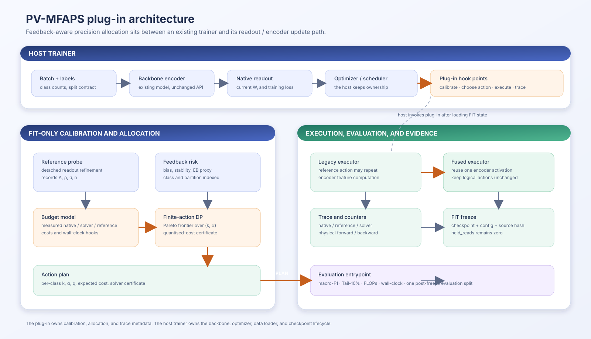
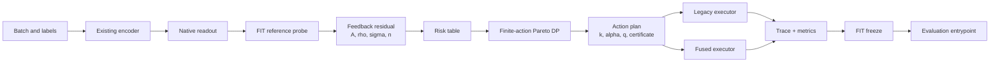

# PV-MFAPS Plugin

**A feedback-aware allocation layer for long-tailed training**

PV-MFAPS is a plug-in layer that can be inserted between an existing trainer and its readout update path. It measures the difference between the current readout feedback and a FIT-only reference feedback, turns that signal into a finite action plan, and exposes a fused execution hook that reuses encoder features when several logical actions share the same batch.

The host trainer keeps its backbone, optimizer, data loader, and checkpoint lifecycle. The plug-in contributes four pieces that can be adopted independently:

1. a class-conditional calibration interface,
2. a finite-action Pareto allocator,
3. long-tail loss helpers,
4. a Fused executor and trace schema for cost accounting.

> The practical design question is simple: when a readout is still moving, which classes deserve another inner step, and how much physical work should that decision cost?

## Architecture



The full execution path is visible in the diagram. FIT calibration produces the quantities used by the allocator. The allocator returns a per-class `(k, alpha)` plan and a certificate. The host can then choose the Legacy or Fused executor while preserving the same logical action sequence.



## Quick start

The package is intentionally small enough to test without PlantSPD or any private checkpoint.

```bash
git clone https://github.com/Oookla28/PV-MFAPS-Plugin.git
cd PV-MFAPS-Plugin
python3 -m venv .venv
source .venv/bin/activate
pip install -r requirements.txt
PYTHONPATH=src python scripts/smoke.py
```

The smoke creates a deterministic twelve-class calibration table, solves the finite action problem, checks the legality rule `k=0 ⇒ alpha=0`, and prints the selected plan and solver certificate.

For a host project, install the package in editable mode.

```bash
pip install -e .
```

## The public API

### Build an action plan

```python
from pv_mfaps_plugin import build_plan

calibration = {
    "A": [1.0, 1.2, 0.8, 1.4],
    "rho": [0.70, 0.80, 0.90, 0.75],
    "sigma": [0.10, 0.12, 0.08, 0.15],
    "n": [5, 8, 16, 32],
}

plan = build_plan(
    calibration,
    budget=0.50,
    k_grid=(0, 1, 2, 4),
    alpha_grid=(0.25,),
)

print(plan.k)
print(plan.alpha)
print(plan.certificate)
```

The calibration arrays are aligned by class. `A` describes the current residual scale, `rho` is the measured inner-loop contraction proxy, `sigma` is the batch variation proxy, and `n` is the FIT support used for calibration. The module validates shapes and rejects illegal action grids.

### Insert the fused execution hook

```python
from pv_mfaps_plugin import FusedExecutor, trace_summary

executor = FusedExecutor(
    encode=encoder,
    head=readout,
    plan=plan,
)
logits, alpha, trace = executor.forward(images, labels)
print(trace_summary(trace))
```

The executor exposes logical action counts and physical encoder counts separately. The host remains responsible for the actual optimizer step. This separation makes a Legacy/Fused comparison auditable under the same action sequence.

### Use long-tail losses

```python
from pv_mfaps_plugin import balanced_softmax_loss, logit_adjusted_cross_entropy

loss = balanced_softmax_loss(logits, labels, class_counts)
# or
loss = logit_adjusted_cross_entropy(logits, labels, class_counts, tau=1.0)
```

When the plug-in is used with a reference readout, the host should apply the same long-tail objective to native, reference, and fused paths. This keeps the feedback comparison on one loss contract.

## Solver contract

The default finite action problem is

$$
\min_{a_1,\ldots,a_C}
\sum_{c=1}^{C}
\left(\frac{\mu}{C}+\nu_c\right)U_c(a_c)
\quad\text{subject to}\quad
\sum_{c=1}^{C} d_c(a_c)\le B.
$$

For a class `c` and action `a=(k, alpha)`, the default proxy is

$$
U_c(k,\alpha)
=(1-\alpha)^2 A_c\rho_c^{2k}
+\alpha^2\frac{\sigma_c^2}{n_c}\xi^k.
$$

The implementation solves this problem on a finite action grid with upward cost quantisation. The returned certificate contains the selected actions, quantised budget, actual expected cost, objective value, and Pareto frontier diagnostics. The certificate describes the solved finite proxy problem. Held-out evaluation remains the responsibility of the host experiment.

The full derivation is in [`docs/derivation.md`](docs/derivation.md).

## Plug-in integration points

| Hook | Input | Output | Host responsibility |
|---|---|---|---|
| `build_plan` | FIT calibration arrays and budget | `ActionPlan` | choose calibration data and schedule |
| `FusedExecutor.forward` | batch, labels, action plan | logits, per-sample alpha, trace | optimizer step and checkpointing |
| `balanced_softmax_loss` | logits, labels, counts | loss tensor | data loader and class-count contract |
| `evaluation.py` | frozen run directory | FIT summary | post-freeze evaluation split |

A recommended run keeps calibration and training in a FIT-only phase. After checkpoints are complete, the host creates a freeze manifest and invokes its evaluation entrypoint once. The plug-in itself never needs to know the path of a private dataset or checkpoint.

## Reference adapter

The source project contains a PlantSPD adapter under `scripts/plantsdp_plugin_runner.py`. It shows how to attach the module to a trainer that already provides a backbone, a reference head, class counts, a measured cost model, and a Fused execution path. The adapter is kept as a reference integration. The standalone API above is the stable surface for other trainers.

A host adapter should provide:

- a `FIT` split and a separate evaluation split,
- class counts with a stable class ordering,
- a deterministic reference probe,
- measured native, solver, and reference costs,
- isolated output directories for each arm and seed,
- a post-freeze evaluation command.

## Evaluation entrypoint

The small evaluation helper reads executed FIT artifacts and aggregates macro-F1, Tail-10, wall-clock, and FLOPs fields.

```bash
PYTHONPATH=src python -m pv_mfaps_plugin.evaluation \
  --run-dir /path/to/run \
  --split fit \
  --output /path/to/fit_summary.json
```

For a host-specific held-out evaluator, keep the freeze and evaluation steps in the host project. The plug-in does not bundle any image dataset or checkpoint.

## What has been measured in the source project

The module was extracted from the validated PlantSPD and CIFAR-LT implementation. The following values are reference measurements from that source project and are included to make the expected scale of the integration concrete.

| Contract | Result |
|---|---:|
| PlantSPD PR-PV-MFAPS versus matched fixed-k | Macro-F1 `0.4841` vs `0.4553`; Tail-10 F1 `0.2976` vs `0.2659` |
| PlantSPD matched cost | maximum FLOPs ratio `0.8889`; maximum wall-clock ratio `0.9974` |
| CIFAR-100-LT Stage-TRR-10, 200 epochs | Macro-F1 `0.4221 ± 0.0064`; Tail-10 F1 `0.2389 ± 0.0110` |
| CIFAR-100-LT corrected Fused/Legacy pair | state max delta `4.47 × 10⁻⁸`; encoder forwards `2,580` vs `54,180` in the paired 30-epoch run |

These measurements belong to the source experiments and are not silently recomputed by the standalone package. They are included as integration references. The package's own smoke only checks the allocator and API contract.

## Repository map

```text
PV-MFAPS-Plugin/
├── README.md
├── LICENSE
├── pyproject.toml
├── requirements.txt
├── configs/
│   └── plugin.yaml
├── docs/
│   ├── architecture.svg
│   └── derivation.md
├── examples/
├── scripts/
│   ├── smoke.py
│   ├── plantsdp_plugin_runner.py
│   └── equivalence_smoke.py
├── src/pv_mfaps_plugin/
│   ├── __init__.py
│   ├── allocator_core.py
│   ├── evaluation.py
│   ├── fused.py
│   ├── losses.py
│   └── policy.py
└── tests/
    └── test_allocator.py
```

`allocator_core.py` contains the finite-action Pareto solver. `policy.py` provides the public plan builder. `fused.py` defines the execution hook and trace schema. `losses.py` keeps the long-tail loss contract in one place. `evaluation.py` provides a compact FIT aggregation entrypoint. The scripts directory contains adapters and smoke checks rather than private orchestration.

## Reproducibility notes

- Python 3.10 or newer is supported.
- The source experiments used PyTorch 2.x and CUDA GPUs. The allocator and smoke also run on CPU.
- Seeds, class ordering, calibration files, action grids, budget scale, and cost model should be written into the host manifest.
- FLOPs and wall-clock should be measured separately. CUDA timing should synchronize before and after the timed region.
- A Fused comparison should reset model state, optimizer state, and random seeds between Legacy and Fused runs.
- No image data, checkpoints, credentials, private paths, or internal experiment logs are part of this repository.

## Citation

If this plug-in is useful in your work, cite the repository using the metadata in [`CITATION.cff`](CITATION.cff).

## License

Released under the MIT License. Dataset and pretrained-weight licenses remain those of their original providers.
