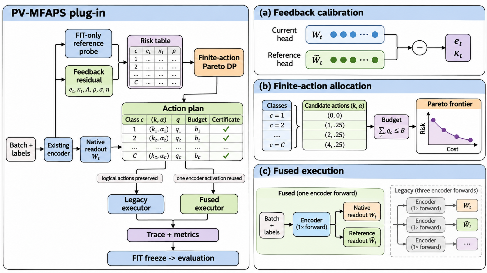

# PV-MFAPS Plugin

**把读出反馈变成可执行的长尾训练动作。**

PV-MFAPS 是一个可以插入现有训练器的模块。它不需要重写 backbone，也不要求改变推理接口。它做的事情集中在训练过程中最容易被忽略的一段：当前分类头还没有稳定下来时，encoder 收到的梯度到底是不是我们希望的梯度，以及在有限计算预算下，哪些类别值得再做几步内循环更新。

如果你第一次接触这个项目，可以先把它理解成三层：

- **测量层**：比较当前读出头和参考读出头对 encoder 产生的反馈。
- **分配层**：根据每个类别的反馈风险，在有限预算中选择 `(k, α)`。
- **执行层**：复用已经算出的 encoder 特征，减少重复前向，并把逻辑动作和真实计算量分别记录下来。

> 训练器决定模型怎样学习，PV-MFAPS 负责回答“这一批数据现在应该把多少精度预算给谁”。

## 先看整体结构

<p align="center">
  
</p>

<p align="center"><a href="docs/architecture_supplied.png">打开完整 PNG</a></p>

图中左侧是一次训练的主流程，右侧是三个关键环节的放大图。数据先进入已有 encoder 和 native readout。FIT-only reference probe 用来估计反馈误差，风险表把这些量整理成每个类别可比较的动作代价，有限动作 DP 再给出具体的动作计划。最后，Legacy 和 Fused 两种执行方式可以在相同逻辑动作下进行对照。

## 数学推导索引

如果你想先理解数学对象，再看代码，可以按下面的顺序阅读：

1. [反馈残差与归一化指标](docs/derivation.md#1-两个读出头回答一个具体问题)
2. [最小二分类例子](docs/derivation.md#2-一个最小的二分类例子)
3. [类别风险表](docs/derivation.md#3-类别风险表)
4. [带预算的离散优化](docs/derivation.md#4-带预算的离散优化)
5. [Pareto frontier 动态规划](docs/derivation.md#5-pareto-frontier-动态规划)
6. [Fused 执行与计算复用](docs/derivation.md#6-fused-执行为什么可以省计算)

## 这个模块解决什么问题

长尾训练里，常见做法是修改类别权重、调整 logits，或者增加采样次数。这些方法直接作用在分类目标上，但训练过程还有另一个变化来源。分类头 `W_t` 还在更新时，它产生的 encoder 梯度可能和“读出已经充分适应当前表示”时的梯度不同。

设当前 encoder 参数为 `ψ`，当前读出为 `W_t`，参考读出为 `W̃_t`。在同一个 FIT batch 上，定义反馈残差

$$
 e_t = \nabla_{\psi} L(\psi_t, W_t)
      - \nabla_{\psi} L(\psi_t, \widetilde W_t).
$$

它回答的是一个很具体的问题：**当前读出没有完全准备好时，encoder 收到的更新信号改变了多少。**

为了让不同训练阶段的数值可以比较，模块还记录归一化指标

$$
 \kappa_t =
 \frac{\lVert e_t\rVert_2}
 {\lVert\nabla_{\psi}L(\psi_t,\widetilde W_t)\rVert_2+\delta}.
$$

这里的 `δ` 只是避免分母接近零。`κ_t` 越大，说明当前读出和参考读出对 encoder 的影响越不一致。模块会把它作为 FIT 诊断和动作选择的输入，而不是把它直接当成泛化定理。

## 安装与第一次运行

```bash
git clone https://github.com/Oookla28/PV-MFAPS-Plugin.git
cd PV-MFAPS-Plugin
python3 -m venv .venv
source .venv/bin/activate
pip install -r requirements.txt
```

先运行不依赖任何真实数据的 smoke。它会构造一个 12 类的校准表，调用 DP，输出每个类别的动作，并检查 `k=0` 时 `α` 是否为零。

```bash
PYTHONPATH=src python scripts/smoke.py
```

如果你的训练器已经准备好了 FIT-only 校准 JSON，可以直接生成动作计划。

```bash
PYTHONPATH=src python scripts/build_action_plan.py \
  --calibration examples/calibration.json \
  --budget 0.50 \
  --output artifacts/action_plan.json
```

输出文件包含动作向量、预算、目标值和求解器信息。它不读取图像，也不读取 held-out split，因此适合先检查策略是否接线正确。

## 三个核心模块

### 1. `policy.py`：从校准量生成动作计划

主入口是 `build_plan`。它接收四组按类别排列的 FIT 校准量：

| 量 | 含义 | 直观理解 |
|---|---|---|
| `A_c` | 当前类别的残差尺度 | 这个类别现在有多难处理 |
| `rho_c` | 内循环收缩率代理 | 读出多走一步后，误差下降得快不快 |
| `sigma_c` | 批次波动代理 | 这个类别的反馈是否容易受 batch 影响 |
| `n_c` | FIT 支持数 | 校准时这个类别有多少样本 |

最小调用例子如下。

```python
from pv_mfaps_plugin import build_plan

calibration = {
    "A": [1.0, 1.2, 0.8, 1.4],
    "rho": [0.70, 0.80, 0.90, 0.75],
    "sigma": [0.10, 0.12, 0.08, 0.15],
    "n": [5, 8, 16, 32],
}

plan = build_plan(
    calibration,
    budget=0.50,
    k_grid=(0, 1, 2, 4),
    alpha_grid=(0.25,),
)

print(plan.k)
print(plan.alpha)
print(plan.certificate)
```

`plan.k[c]` 是类别 `c` 的内循环步数，`plan.alpha[c]` 是参考反馈混合比例。动作网格是离散的，默认候选为 `(0,0)`、`(1,0.25)`、`(2,0.25)` 和 `(4,0.25)`。这让每次分配都可以被打印、检查和复现。

### 2. `allocator_core.py`：有限动作 Pareto DP

模块把每个类别的候选动作写成一张小表。每个动作都有风险值和成本值，然后逐类累积。

默认风险代理写成

$$
 U_c(k,\alpha)=(1-\alpha)^2 A_c\rho_c^{2k}+\alpha^2\frac{\sigma_c^2}{n_c}\xi^k.
$$

第一项表示读出精化带来的偏差变化。第二项表示参考反馈和小样本波动带来的稳定性代价。`ξ` 是一个可配置的增长因子。

整体优化目标是

$$
 \min_{a_1,\ldots,a_C}
 \sum_{c=1}^{C}
 \left(\frac{\mu}{C}+\nu_c\right)U_c(a_c)
 \quad\text{subject to}\quad
 \sum_{c=1}^{C} d_c(a_c)\le B.
$$

- `a_c` 是类别 `c` 的动作。
- `d_c(a_c)` 是该动作的成本。
- `B` 是总预算。
- `μ` 控制整体风险。
- `ν_c` 可以提高尾部类别的权重。

求解器使用 Pareto frontier 保存状态。对同一个量化成本，如果某个状态的风险和目标值都不优于另一个状态，就把它删掉。最终保留下来的最优状态就是**给定动作网格和量化成本问题上的离散解**。

求解证书会记录：

- 动作网格
- 成本量化比例
- 最终量化成本
- 实际期望成本
- 目标值
- 每一阶段的 frontier 大小

### 3. `fused.py`：把逻辑动作变成实际执行

`FusedExecutor` 接收 host trainer 提供的 `encode` 和 `head` 函数。它在一次 batch 中先算出 encoder 特征，再把这个特征交给 native/reference readout 分支。

```python
from pv_mfaps_plugin import FusedExecutor, trace_summary

executor = FusedExecutor(
    encode=encoder,
    head=readout,
    plan=plan,
)

logits, alpha, trace = executor.forward(images, labels)
print(trace_summary(trace))
```

这里有两个容易混淆的计数：

- **逻辑计数**：算法要求执行了多少次 native、reference 或 solver action。
- **物理计数**：GPU 实际做了多少次 encoder forward/backward。

Fused 的目标是保持逻辑动作不变，同时复用 encoder activation。Legacy/Fused 对照时，需要重新设置模型、优化器和随机种子，并在同一块 GPU 上同步计时。

## 长尾损失

模块提供两个常用的 loss helper。

```python
from pv_mfaps_plugin import balanced_softmax_loss, logit_adjusted_cross_entropy

loss = balanced_softmax_loss(logits, labels, class_counts)
loss = logit_adjusted_cross_entropy(logits, labels, class_counts, tau=1.0)
```

如果训练器同时有 native、reference 和 Fused 分支，三者应使用同一套长尾 loss。否则反馈差异里会混入 loss 定义差异，难以判断变化来自读出精化还是来自类别先验。

## 评估入口

训练过程只写 FIT 结果。模型、配置和来源哈希全部保存后，再调用 evaluation 入口。

```bash
PYTHONPATH=src python -m pv_mfaps_plugin.evaluation \
  --run-dir /path/to/run \
  --split fit \
  --output /path/to/fit_summary.json
```

聚合结果包含：

- Macro-F1
- Tail-10 F1 或 Tail-10 recall
- wall-clock
- FLOPs
- 每个 arm 的运行数量

真实项目中的 held-out evaluator 应由 host trainer 管理。这样数据集划分、冻结时机和一次性读取规则可以在同一个实验合同中保持一致。

## 接入已有训练器需要准备什么

一个 host adapter 至少需要提供：

1. FIT 数据和独立 evaluation 数据。
2. 稳定的类别顺序和类别计数。
3. 固定的 reference probe。
4. native、solver、reference 的实际成本记录。
5. 每个 arm 和 seed 独立的输出目录。
6. 训练完成后的 freeze 和 evaluation 入口。

建议接入顺序如下：

```text
读取 FIT checkpoint
      ↓
建立 reference probe
      ↓
计算 A / rho / sigma / n
      ↓
调用 build_plan
      ↓
执行 Legacy 或 Fused
      ↓
写入动作和计数 trace
      ↓
冻结 checkpoint
      ↓
单独运行 evaluation
```

## 源项目中的参考测量

下面的数字来自源项目已经完成的 PlantSPD 和 CIFAR-LT 执行合同，用来帮助使用者判断模块接入后的量级。独立仓库中的 smoke 不会重新读取这些数据，也不会把这些数字当作本包自动产生的结果。

| 执行合同 | 参考结果 |
|---|---:|
| PlantSPD，PR-PV-MFAPS 对 matched fixed-k | Macro-F1 `0.4841` 对 `0.4553`，Tail-10 F1 `0.2976` 对 `0.2659` |
| PlantSPD，匹配执行成本 | 最大 FLOPs 比 `0.8889`，最大 wall-clock 比 `0.9974` |
| CIFAR-100-LT Stage-TRR-10，200 epoch | Macro-F1 `0.4221 ± 0.0064`，Tail-10 F1 `0.2389 ± 0.0110` |
| CIFAR-100-LT Fused/Legacy 配对 | state max delta `4.47 × 10⁻⁸`，配对 30 epoch 中 encoder forward `2,580` 对 `54,180` |

## 目录结构

```text
PV-MFAPS-Plugin/
├── README.md
├── LICENSE
├── CITATION.cff
├── pyproject.toml
├── requirements.txt
├── configs/plugin.yaml
├── docs/
│   ├── architecture_supplied.png
│   └── derivation.md
├── examples/calibration.json
├── scripts/
│   ├── smoke.py
│   ├── build_action_plan.py
│   └── equivalence_smoke.py
├── src/pv_mfaps_plugin/
│   ├── __init__.py
│   ├── allocator_core.py
│   ├── evaluation.py
│   ├── fused.py
│   ├── losses.py
│   └── policy.py
└── tests/test_allocator.py
```

## 常见误区

- `k` 越大不一定越好。小样本类别的波动项可能随着精化动作增加。
- `κ` 是反馈诊断量，不等于分类准确率，也不自动等于总体泛化误差。
- DP 证书只描述给定风险表、动作网格和量化成本下的离散问题。
- FLOPs 下降不一定带来同等 wall-clock 下降。数据加载、同步和 kernel launch 需要单独测量。
- 训练阶段不应提前读取 evaluation split。冻结、读取次数和来源哈希应写入 host manifest。

## 复现环境

- Python 3.10 或更新版本
- NumPy 1.24 或更新版本
- PyTorch 2.x
- 源项目使用 NVIDIA CUDA GPU 进行训练
- allocator smoke 可以在 CPU 上运行

完整运行命令、随机种子、类别顺序、校准文件、动作网格和成本模型应由 host 项目写入自己的实验 manifest。这个独立仓库不包含图像、checkpoint、服务器信息或内部研究日志。

## 引用与许可

引用信息见 [`CITATION.cff`](CITATION.cff)。代码使用 MIT License。数据集和预训练权重仍遵循各自的原始许可。
